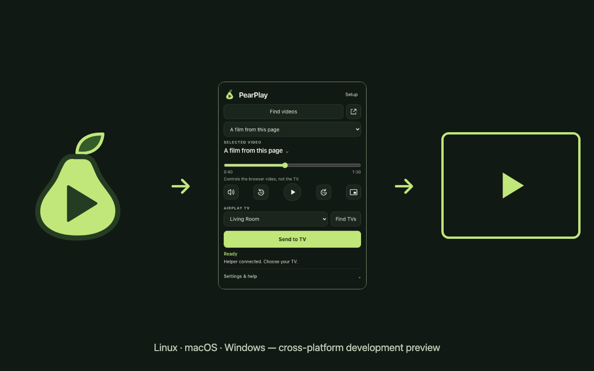

# PearPlay

### Your browser’s video. Your Apple TV.

PearPlay is a Chrome extension for sending compatible web videos directly to Apple TV—without screen mirroring, re-encoding or a cloud relay. A separate local helper is required.

**[Website and getting started](https://jcarcinogen.github.io/PearPlay/)** · **[Add to Chrome](https://chromewebstore.google.com/detail/pearplay/eoadahoncjfpnennmkjifohclbafjkol)**

**PearPlay 0.3.3 · Linux, Mac and Windows Chrome · Separate local helper required.** Install the extension from the Chrome Web Store and helper 0.3.3 for your computer. Fedora 44 also uses helper 0.3.3.

[Download helpers](https://github.com/jcarcinogen/PearPlay/releases/tag/v0.3.3)

[Chrome Web Store](https://chromewebstore.google.com/detail/pearplay/eoadahoncjfpnennmkjifohclbafjkol) · [Installation guide](docs/install.md)

&nbsp;&nbsp;

*Actual extension interface with example data—not a live playback screenshot.*

## What works

- **Official Apple TV:** Mac Chrome pairing, MP4 picture and sound, and session ending were owner-tested with an earlier helper. Linux has prior owner-confirmed Apple TV playback in Chrome, Brave and Chromium; Chrome sound was separately confirmed.
- **Other AirPlay TVs: playback unverified.** They may appear in discovery. Compatibility varies by TV and stream.
- **Windows preview:** Chrome browser controls and Apple TV picture, sound, pause/resume and End helper session have passed recorded checks. The fully branded 0.3.1 installer passed exact-install/repair/update/removal and registry/hash checks on a clean hosted Windows runner. Windows security policy may block unsigned builds; the owner installed 0.3.3 after his explicit security-policy decision, not trusted signing. Trusted Windows signing is not currently available; stop if blocked rather than disabling security.
- **Mac preview:** Apple silicon only, unsigned package and ad-hoc-signed app, not Apple Developer ID signed or notarized. Brave shares Chrome’s registration, but Mac Brave playback is unverified. No Intel Mac installer.

The Safari extension is paused. Snap/Flatpak browsers, browser beta/dev channels, Linux/Windows ARM and Windows Edge/Brave are not advertised installer targets.

## Get started

1. Download the helper for your computer from [0.3.3 releases](https://github.com/jcarcinogen/PearPlay/releases/tag/v0.3.3). Compare its checksum with `SHA256SUMS`.
   - **Mac Apple silicon:** `pearplay-helper-0.3.3-darwin-arm64-development.pkg`. Follow the [unsigned Mac guide with screenshots](docs/mac-install.md).
   - **Windows x86_64:** `pearplay-helper-0.3.3-windows-x86_64-unsigned.exe`. Follow the [Windows guide](docs/windows-helper.md); keep SmartScreen and Defender enabled.
   - **Ubuntu/Debian x86_64:** 0.3.3 `.deb`, glibc 2.39+ baseline.
   - **Arch/Omarchy:** 0.3.3 `.pkg.tar.zst`, glibc 2.39+. **Fedora 44:** [0.3.3 RPM](https://github.com/jcarcinogen/PearPlay/releases/tag/v0.3.3), glibc 2.43+.
2. Install the helper, open **PearPlay Setup**, and connect your browser. Python is bundled; no manual extension-ID command is needed. Mac Chrome and Brave share one connection, including disconnection. Windows installs for your Windows account.
3. **Fully quit and reopen the browser.** Closing a tab or reloading the extension is not enough.
4. Install **[PearPlay from the Chrome Web Store](https://chromewebstore.google.com/detail/pearplay/eoadahoncjfpnennmkjifohclbafjkol)**. Developer mode is not needed for the Store install. For local development only, the release ZIP can still be extracted and loaded unpacked; keep its extracted folder in place.
5. In PearPlay’s **Setup** tab, select **Check connection**. Put the computer and TV on the same trusted network with AirPlay enabled.

## Send a video

1. Choose **Allow all websites**, start the website’s video, then **Find videos**.
2. Select the video and **Find TVs**. Choose your Apple TV. Enter any on-screen PIN only in PearPlay’s masked **TV PIN** field, then **Pair TV**.
3. Choose **Send to TV**. Check for picture and sound. Use **Mute browser video** to silence duplicate browser sound without muting the TV.
4. Use **End helper session** when finished. If the TV keeps playing, stop it with its remote.

After a failed pairing, choose **Show a new PIN** and try again. Pairing never automatically sends a video.

## Helper updates

The Web Store updates the extension, not the helper. If the popup says TV progress needs helper 0.3.3, open Setup and use the download for your computer. End casting, fully quit browsers, install/update the helper, reopen the browser and **Check connection**. Saved TV pairing is kept; no uninstall or pairing reset is needed.

## Limits and privacy

- Only directly fetchable HTTP(S) media works. Browser-only `blob:` URLs, cookies, DRM and access restrictions are not bypassed. Not every website or stream works. PearPlay does not block ads.
- **Browser controls:** play/pause, timeline, 5/10/15/30-second jumps, mute and Picture in Picture before casting. These do not control the TV. **TV controls:** Pause TV / Resume TV with helper 0.3.1+ and a supported authenticated Apple TV session; read-only TV progress needs helper 0.3.3. The active cast survives popup reopening and tab switching. Deliberate **Mute browser video** targets only the original video, not your TV; no automatic mute or restoration. A preferred TV is remembered by identity and selected after rediscovery, not by saving media URLs. Fedora 44 helper 0.3.3 provides the same capability-gated controls. TV seeking, jumps and volume are unsupported; use the TV remote. **End helper session** closes the connection, not a universal TV-stop guarantee.
- All-sites access is currently required for discovery, even though a per-site grant is also offered.
- No PearPlay account, cloud relay or first-party telemetry uploader. The media site and TV still use the network; local control is not anonymity. See [privacy](docs/privacy.md).
- Pairing stays local to the OS user; Windows uses DPAPI protection. Pairings are not portable between OSes/users/computers. One helper session can be active per user.
- Keep normal OS and firewall protections enabled. Mac’s optional per-item **Open Anyway** is a deliberate trust decision, not notarization; stop on malware/damage warnings. Never disable Gatekeeper, remove quarantine or disable SmartScreen/Defender to install this preview.

## Documentation

[Install / repair / removal](docs/install.md) · [Mac screenshots](docs/mac-install.md) · [Windows helper](docs/windows-helper.md) · [Release scope](docs/cross-platform-preview.md) · [Helper](helper/README.md) · [Control contract](contract/v1.md) · [Tests](tests/) · [Website](https://jcarcinogen.github.io/PearPlay/)

## License and affiliation

Original code: [MIT](LICENSE). The command adapter retains its [license and provenance](spikes/002-command/LICENSE.md); third-party notices apply. PearPlay is independent and unaffiliated with Apple. The working name has not been trademark-cleared.
