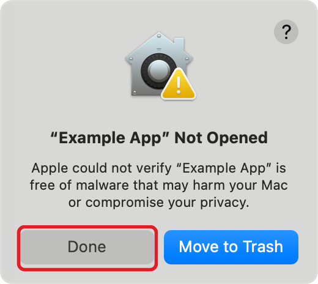
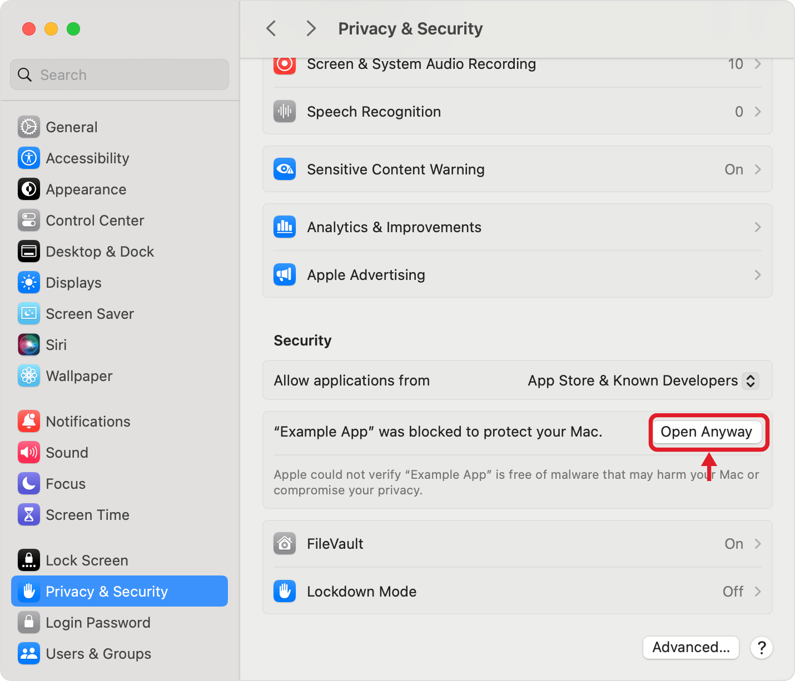
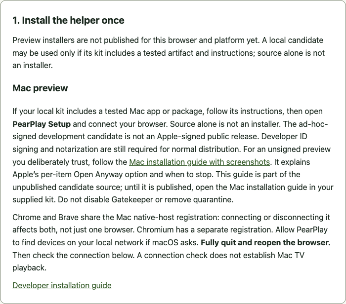

# Install the unsigned Mac helper

**For people deliberately testing the PearPlay Mac preview.** The current package is for **Apple silicon Macs (M1 or later)**. No Intel Mac package is supplied. This is not an Apple-signed or notarized release. If you prefer not to make a security exception, **stop here and wait for a signed release**.

> **Download:** get the Mac package and `SHA256SUMS` from the [0.3.0 release](https://github.com/jcarcinogen/PearPlay/releases/tag/v0.3.0). Official Apple TV MP4 picture and sound were owner-tested on Mac Chrome; other AirPlay TVs remain playback unverified. This is still an unsigned preview.

## 1. Check your Mac and the download

1. Choose **Apple menu → About This Mac**. Look for an Apple M-series chip. An **Intel** processor is not supported by this package.
2. Get `pearplay-helper-0.3.0-darwin-arm64.pkg` from the trusted 0.3.0 release. Keep its original filename. Do not use a file from an unsolicited message or another download site.
3. Compare its SHA256 with the release’s **SHA256SUMS**. Open **Terminal**, type `shasum -a 256` followed by a space, drag the downloaded `.pkg` into Terminal, and press Return. Dragging inserts the path; it does not run the file. The long value must match exactly. A matching checksum detects a changed download; it **does not** provide Apple signing, notarization, or a guarantee of safety.
4. End any current TV session and fully quit Chrome and Brave before installation. Do not replace an existing development installation if you do not know how it was installed—use its original removal instructions first.

## 2. Open the package once

Double-click the `.pkg` in Finder. If Installer opens normally, continue to step 4 below.

If macOS says the developer cannot be verified or Apple could not verify that it is free of malware, dismiss that warning with **Done** or **OK**. Read it; unsigned software carries extra risk.

*Screenshot: Apple Support’s macOS example, with a red outline added around Done; not an observed PearPlay install. “Example App” stands for the blocked item. Your Mac may use different wording and display the PearPlay package filename.*

**Stop instead of continuing** if the alert says the software **will damage your computer**, **contains malware**, **is damaged**, or has been moved to Trash. Also stop if the filename or checksum is wrong. Those warnings are not the routine unidentified-developer case covered by the next step.

## 3. Optional: approve only this trusted PearPlay item

Only continue if you obtained the exact preview deliberately, checked the file, and accept the risk of software Apple has not verified.

1. Open **Apple menu → System Settings → Privacy & Security**.
2. Scroll down to **Security**. Find the message about the **same PearPlay package you just tried to open**.
3. Click **Open Anyway** for that item. Some macOS versions show an **Open** control first, followed by **Open Anyway**.
4. Review the next confirmation and choose **Open** only if it still names the expected item. If macOS asks for your Mac login password or Touch ID, enter it **only in the system prompt**—never send it to someone helping you.

*Screenshot: Apple Support, macOS Sequoia, with a red arrow and outline added around Open Anyway. It is an example of where to look, not a PearPlay-specific permission already granted. Newer macOS may arrange the controls differently.*

**No Open Anyway button?** Apple says it is available for about an hour after the blocked attempt. Try opening the same package once more, then return to this pane. If the control is still absent, disabled, names a different item, or your Mac is managed by work/school, **stop and ask the administrator or wait for a signed build**. Do not change “Allow applications from,” use Terminal security overrides, remove quarantine, or reset privacy permissions.

This is an exception for one item; Gatekeeper stays enabled. It does **not** sign or notarize PearPlay and does not close the project’s signed-distribution gate.

## 4. Install, then open PearPlay Setup

1. In **Installer**, follow **Continue → Install**. Review the destination and normal administrator prompt before proceeding. Enter credentials only in macOS’s own prompt.
2. When installation finishes, open **Finder → Applications → PearPlay Setup**.
3. If macOS separately blocks **PearPlay Setup**, the app is a second item. Apply step 3 only to that exact app if you still wish to trust it; approving the package does not guarantee the app will be accepted. If a nested helper is blocked or the named item is unclear, stop rather than approve an unfamiliar executable.
4. Select **Google Chrome and Brave (shared connection)**, then **OK**. On a later launch, choose **Connect or repair browsers** first. You do not need Brave installed to use Chrome.
5. Read the result. Chrome and Brave share this Mac connection, so connecting or disconnecting it affects **both**. Chromium has its own separate choice. If the result says existing files were preserved or could not be connected, stop and use the original installation’s repair/removal instructions; do not overwrite unknown files.

The package supplies the helper’s Python runtime. You do not need to install Python, paste an extension ID, or run a Linux installation command.

## 5. Restart Chrome and check the connection

1. Fully quit Chrome with **Chrome → Quit Google Chrome** (Command-Q), then reopen it. Closing a tab is not enough. Restart Brave too if you use it.
2. Until the Store update is approved, extract `pearplay-0.3.0.zip` from the release, open `chrome://extensions`, enable Developer mode and Load unpacked from its extracted folder. Keep the folder in place; use a separate preview profile if you already use the Store extension.
3. Click PearPlay in the toolbar, then **Setup → Check connection**.
4. Wait for the connected message. A successful connection means the browser can talk to the helper; it does **not** mean your TV was found or that video and sound work.

*Actual PearPlay setup document in an isolated Chrome profile. This capture used the missing-helper state, not a successful install. No personal browser profile or device names appear.*

## 6. Find your TV—this is a separate check

Wake your TV, enable AirPlay, and use the same trusted home network as your Mac. Click **Find my TV** yourself. Review any macOS Local Network prompt for the expected app/browser; allow access only if you want it to discover home devices. Do not grant unrelated privacy permissions.

**Mac discovery evidence:** an earlier browser-launched run found no TVs while direct launch found one. A later bounded check of the same frozen helper found two receivers in both direct launches and in Chrome before and after a full restart, without permission or signing changes. The earlier difference was not reproduced; its cause remains unknown. This does not prove clean-install Local Network consent or reliable discovery on every network. If no TV appears after normal consent and one retry, stop and report “helper connected; no TVs found.” Do not reset privacy databases, change firewall policy, borrow another app’s permission, or repeatedly try pairing. Use the candidate kit’s latest verification matrix for the final finding.

Once a TV appears, choose your video and TV, pair if asked, then **Send to TV**. Check picture and sound, and use **End helper session** when finished; if playback continues, use the TV remote. Enter a TV PIN only in PearPlay’s masked field—not in a report or message. LG-specific HLS troubleshooting is not part of this installation guide.

## If you want to undo it

End the TV session first. Open **PearPlay Setup → Disconnect browsers**, select the shared Chrome/Brave connection (and Chromium only if you connected it), and confirm the result. Fully quit those browsers. Move **PearPlay Setup** from Applications to Trash using Finder’s normal authorization if requested. Saved TV pairing is intentionally kept; uninstalling the browser extension alone does not remove the helper. Stop if changed or unknown files are reported; do not delete them by guessing.

## What these instructions and screenshots prove

The two security screenshots are **Apple’s published examples**, not fabricated PearPlay screens and not evidence that this preview passed Gatekeeper, installation, discovery or playback. This guide describes a **user-controlled** unsigned-install route. Owner installation, Chrome connection, pairing and official Apple TV MP4 picture/sound were verified with this repaired helper. These observations do not establish every clean-download consent journey or receiver. Developer ID signing and notarization remain future work.

Sources: [Apple: Safely open apps on your Mac](https://support.apple.com/en-us/102445) · [Apple: Open a Mac app from an unknown developer](https://support.apple.com/guide/mac-help/open-a-mac-app-from-an-unknown-developer-mh40616/mac). Example screenshots are © Apple, reproduced for instructional context; see [image provenance](images/mac-install/SOURCES.md).

[All platform installation options](install.md) · [Preview scope and verification boundaries](cross-platform-preview.md)
